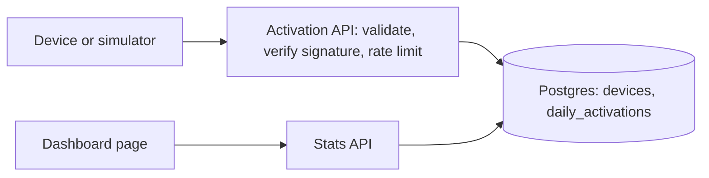
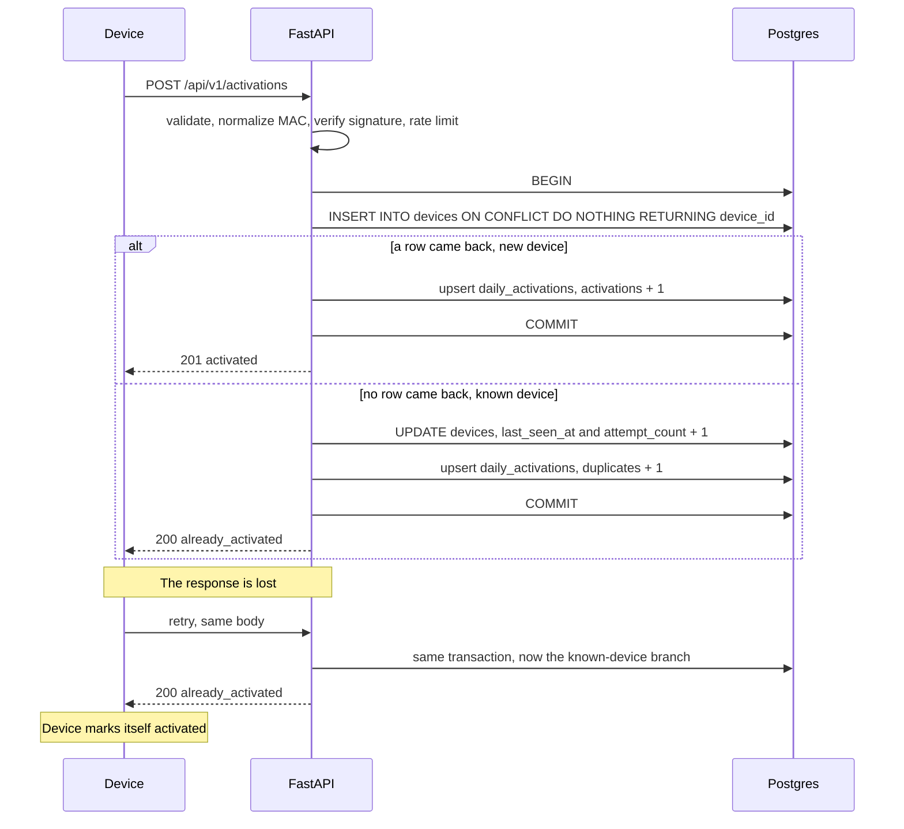

# Activation Server

Devices send a message when they boot. This service records each device once, at its first-ever activation, and shows the totals on a dashboard by time and by model. The hard problem is counting each device exactly once when devices retry after failures and many requests for the same device arrive at the same time. The design below makes the database enforce that, not the application code.

## Status

Design only. Implementation lands step by step; see the commit history.

## Requirements

- Accept an activation message from a device on boot.
- Count each device exactly once, no matter how many times it boots or retries.
- Be safe under concurrent requests for the same device.
- Show counts on a dashboard by time and by model.
- Reject forged, malformed and abusive requests.
- Run locally with Docker.

Firmware version, OS version and region are stored on the device row for future breakdowns. The dashboard does not show them yet.

## Confirmed and chosen

### Confirmed

The hiring manager confirmed one thing. Everything else was left open.

- Devices are identified by their MAC address, which is unique.

What follows from that is our reading, not part of the confirmation: a factory MAC survives a factory reset, so a device is activated once in its lifetime. We also assume the firmware always sends the same interface's MAC. Which interface that is stays the device team's decision.

### Chosen by us

| Choice | Why |
|---|---|
| Payload: `device_id` (the MAC), `model`, `os_version`, `firmware_version`, `region`, `device_time` (ISO 8601). | Smallest payload that supports the dashboard and future breakdowns. |
| Activation time is the server receive time in UTC. `device_time` is stored, never trusted. | A device clock can be wrong on first boot. The server clock is the only one we control. |
| Devices retry, so duplicates are normal. The endpoint is idempotent. | Embedded clients lose responses and resend. |
| Daily buckets use Asia/Jerusalem time. | The reader of the dashboard is assumed to be in Israel. |
| The response is an acknowledgement only: 201 or 200 with a status. | The device needs to know one thing: stop retrying. |
| Device simulation is a script first. An Android emulator app is a bonus. | The script is repeatable and runs on any machine. The app adds realism but not correctness. |
| Submission is a public GitHub repo with this README. | Easy for a reviewer to open and read. |

## Architecture

- Devices talk only to the activation endpoint. It validates the body, checks the per-device signature and applies a rate limit before touching the database.
- Both APIs run in one FastAPI app and share one Postgres database.
- Postgres holds one row per device and a small daily rollup.
- The dashboard is a static page served by the same app. It calls the stats API.
- The stats API reads only the rollup. It never scans the devices table.

## Activation flow

## Data model

`devices`: one row per device.

| Column | Type | Meaning |
|---|---|---|
| `device_id` | TEXT PRIMARY KEY | Factory MAC address, normalized to uppercase colon form. The uniqueness guarantee. |
| `model` | TEXT | Device model, from the first activation. |
| `os_version` | TEXT | OS version, from the first activation. |
| `firmware_version` | TEXT | Firmware version, from the first activation. |
| `region` | TEXT | Region, from the first activation. |
| `first_activated_at` | TIMESTAMPTZ | Server receive time of the first activation, stored in UTC. |
| `device_reported_at` | TIMESTAMPTZ | `device_time` as sent. Informational only. |
| `last_seen_at` | TIMESTAMPTZ | Server receive time of the latest message. |
| `attempt_count` | INTEGER | Number of messages received, including the first. |

`daily_activations`: the rollup the dashboard reads.

| Column | Type | Meaning |
|---|---|---|
| `day` | DATE | Asia/Jerusalem calendar day of the server receive time. |
| `model` | TEXT | Model stored on the device row. |
| `activations` | INTEGER NOT NULL DEFAULT 0 | New devices that day. |
| `duplicates` | INTEGER NOT NULL DEFAULT 0 | Repeat messages blocked that day. |

Primary key: `(day, model)`.

Invariants, both checked by tests:

- `SUM(activations) = COUNT(devices)`
- `SUM(duplicates) = SUM(attempt_count - 1)`

A duplicate is counted under the model stored on the device row, not the model in the retry payload, because the retry payload is untrusted.

## Why the count is correct

- `device_id` is the primary key. The database allows only one row per device.
- The MAC is normalized to uppercase colon form before anything else uses it. Without this, the same MAC sent as `aa-bb-cc-dd-ee-01` and `AA:BB:CC:DD:EE:01` would be counted as two devices.
- `INSERT ... ON CONFLICT DO NOTHING RETURNING device_id` is one atomic statement. Exactly one concurrent request gets a row back. That request increments `activations`. The others take the duplicate branch.
- Check-then-insert breaks under concurrency. Two requests can both see "not found", both insert, and both count. A unique key with `ON CONFLICT` has no such gap.
- The device row and the rollup change in the same transaction, so they cannot drift apart.
- The server clock sets the activation time and the Israeli day. `device_time` can be wrong on first boot.
- Device rule: mark the device as activated only after receiving a 200 or 201. Until then, keep retrying. Retries are safe.

## Decisions and trade-offs

| Decision | Why | Rejected alternative |
|---|---|---|
| Normalized MAC address as the unique key | Confirmed device identity. Stable across reboots and factory resets. One canonical form gives one row per device. | Storing the MAC as sent: the same device is counted twice when formats differ. |
| Reject broken or self-assigned MACs | All-zero, broadcast, multicast and locally administered addresses are not unique hardware identities. Failing loudly beats a silent wrong count. | Accept them: one device counted twice, or many devices counted as one, with no error. |
| Single-statement `INSERT ... ON CONFLICT DO NOTHING` | Atomic. No race window. | Check-then-insert, or select-for-update then insert: race or extra locking. |
| One row per device plus an attempt counter | Storage grows with devices, not with messages. | Log every message: grows without bound, and counting needs a scan. |
| Daily rollup with `activations` and `duplicates` | Dashboard reads a few rows. Both counters update in the same transaction as the write. | `COUNT(*)` over `devices` per dashboard load: slow at scale. |
| TIMESTAMPTZ in UTC, displayed in Israel time | One unambiguous instant. Day bucketing is explicit and handles DST. | Local timestamps without zone: ambiguous around DST changes. |
| Postgres in Docker | Real concurrent writers. Same engine as production. | SQLite: one writer at a time. |
| Connection pool sized by an env var | Tunable per environment without a code change. | Connection per request: slow, can exhaust Postgres. |
| Dashboard served by the same app | One thing to deploy. Reuses the auth and the stats API. | A separate BI tool: more infrastructure for a small dashboard. |
| Per-device HMAC key derived from a master secret | A key leaked from one device does not unlock the fleet. No factory key was given, so we derive one. | One shared API key: one leak compromises every device. |
| No replay window | Replaying an activation is a no-op because the endpoint is idempotent. First-boot clocks are unreliable, so a timestamp check would reject real devices. | Timestamp plus nonce: adds state and breaks on bad clocks. |

## Security model

| Threat | Protection here | In production |
|---|---|---|
| Forged activation | Per-device HMAC-SHA256 signature over the raw body, compared with `hmac.compare_digest`. Wrong or missing signature gives 401. | Keys provisioned at the factory, ideally in secure hardware. |
| One device key leaks | Key is derived per device from the normalized MAC. It only works for that device. | Rotation and revocation process. |
| Replayed request | Harmless. Idempotency makes a replay a no-op. | Same. |
| Broken or self-assigned MAC | All-zero, broadcast, multicast and locally administered MACs get 422 with a clear error. | Same, and the device team fixes the firmware. |
| Malformed or hostile input | Strict validation: MAC format checked, other strings max 64 chars, unknown fields rejected with 422. | Same, plus a gateway schema check. |
| Oversized body | Bodies over 4 KB are rejected with 413. | Enforced at the gateway as well. |
| Flooding | In-memory token bucket per client IP, 429 when empty. | A shared limiter or a gateway. In-memory state is per process and resets on restart. |
| Unauthorized dashboard or stats access | HTTP Basic auth. Credentials come from env vars. | SSO or an identity-aware proxy. |
| Script injection through device strings | Stored as plain data. The dashboard renders with `textContent`, never `innerHTML`. SQL is parameterized. | Same, plus a content security policy. |
| Secret exposure | All secrets from env vars. `.env` is git-ignored. Startup fails if a secret is missing. | A secret manager. |
| Network eavesdropping | Not covered in the local setup. | TLS everywhere. |

## Scale

The peak request rate matters, not the total device count. An activated device does not resend after a power outage. Real bursts come from a large shipment or launch day, and from the server coming back after downtime, when every waiting device retries at once. Devices should use backoff with jitter. The rollup keeps the dashboard cost flat: it reads a few rows per day and model, whatever the device count. At 100x, the changes are a queue in front of the database to absorb bursts, more app instances behind a load balancer, and partitioning. Measured numbers will come from `scripts/load_test.py` in step 8.

## Questions asked

| Question | Answer |
|---|---|
| Device message example and identity, factory key or certificate? | Identify by MAC address. No factory key given, so we derive a per-device key. |
| First activation detected by the identifier, not by a flag in the message? | Our choice: yes, by the identifier. |
| What does the device get back? | Our choice: an acknowledgement only. |
| Android simulation: emulator app or a browser page? | Our choice: simulator script first, emulator app as a bonus. |
| Submission format? | Our choice: public GitHub repo with this README. |
