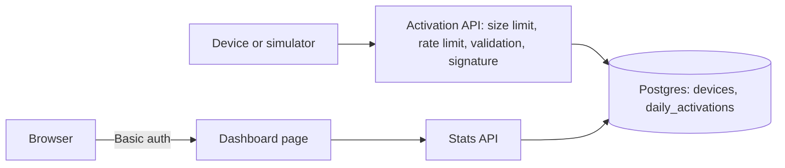
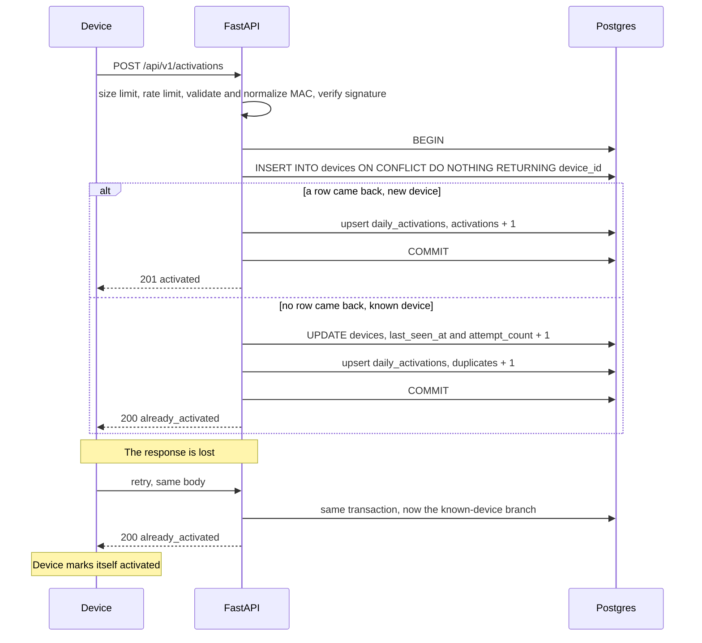

# Activation Server

Devices send a message when they boot. This service records each device once, at its first-ever activation, and shows the totals on a dashboard by day and by model. The hard part is counting each device exactly once when devices retry after failures and many requests for the same device arrive at the same time. The design makes the database enforce that, not the application code.

## Quick start

Prerequisites:

- Docker Desktop, running.
- Python 3.11 or newer. No packages and no virtual environment are needed for the demo.
- Internet access: the first build downloads images and packages (a few minutes), and the dashboard loads Chart.js from a CDN.
- Port 8000 free on this machine.

From the repository folder:

```
python scripts/demo.py
```

The script:

1. Creates `.env` from `.env.example` if it is missing. The placeholder values are fine for a local demo.
2. Checks that Docker is available and that port 8000 is free.
3. Builds the server image and starts the server with its own demo Postgres (Docker project `activation-demo`, separate from any development database).
4. Waits for `/health`.
5. Runs the device simulator twice with the same seed: 5000 Android-style devices activating over the last 30 days, about a quarter of them resending.
6. Fails unless the first run reports every device as new and the second run reports 0 new.

Then open the dashboard:

```
http://127.0.0.1:8000/dashboard
```

The browser asks for a username and password: `DASHBOARD_USER` and `DASHBOARD_PASSWORD` from `.env` (`admin` / `change-me-too` with the placeholders). The root URL `/` redirects to the dashboard. The API docs are at `http://127.0.0.1:8000/docs`.

Stop the demo and delete its data (the demo database only):

```
docker compose -p activation-demo -f docker-compose.demo.yml down -v
```

### What the demo proves

Each simulator run checks itself in two independent ways:

- From the responses: no device got 201 (counted) more than once, and every device ended with 200 or 201.
- Against the server: it reads the all-time totals from `/api/v1/stats` before and after the run. The increase in activations must equal the number of 201 responses, and the increase in repeat requests must equal the number of 200 responses.

The second run sends the same 5000 devices again. Every one of them gets 200 and the activation total does not move. That is the "counted exactly once" property, shown on live data.

## Dashboard

- Date range (Israel days, up to one year) and a model filter. Apply reloads the data; there is no auto-refresh.
- Summary table: activated and repeat requests in the range, and all-time totals.
- Daily chart: activated and repeat requests per day.
- Cumulative chart: starts from the total activated before the range, not from 0, so it shows the real installed base. The y-axis is scaled to the data and does not start at 0.
- Bar chart: activated per model in the range.

"Repeat requests (not counted)" are messages from devices that were already activated. They are not counted as activations. They are shown because they prove that retries reach the server, are recognized and are ignored, and because a rise in them is an early warning that devices are not receiving responses (network trouble or a slow server).

## Requirements

- Accept an activation message from a device on boot.
- Count each device exactly once, no matter how many times it boots or retries.
- Be safe under concurrent requests for the same device.
- Show counts on a dashboard by time and by model.
- Reject forged, malformed and abusive requests.
- Run locally with Docker, with one command.

Firmware version, OS version and region are stored on the device row for future breakdowns. The dashboard does not show them yet.

## Confirmed and chosen

### Confirmed

The hiring manager confirmed one thing. Everything else was left open.

- Devices are identified by their MAC address, which is unique.

What follows from that is our reading, not part of the confirmation: a factory MAC survives a factory reset, so a device is activated once in its lifetime. We also assume the firmware always sends the same interface's MAC. Which interface that is stays the device team's decision.

### Chosen by us

| Choice | Why |
|---|---|
| Payload: `device_id` (the MAC) and `model` are required. `os_version`, `firmware_version`, `region` and `device_time` (ISO 8601) are optional. | Rejecting a real activation because of a missing optional field would lose a count, which is the worst failure here. |
| Activation time is the server receive time in UTC. `device_time` is stored, never trusted. | A device clock can be wrong on first boot. The server clock is the only one we control. |
| Devices retry, so duplicates are normal. The endpoint is idempotent. | Embedded clients lose responses and resend. |
| The first activation is a snapshot. A retry never overwrites model, versions, region or `device_time`. | The retry payload is untrusted and may differ. |
| Daily buckets use Asia/Jerusalem time, computed inside Postgres. | The reader of the dashboard is assumed to be in Israel. Doing it in SQL needs no time zone package on Windows. |
| The response is an acknowledgement only: 201 or 200 with a status. | The device needs to know one thing: stop retrying. |
| Device simulation is a script. An Android emulator app was left for later. | The script is repeatable and runs on any machine. An app adds realism but not correctness. |
| Submission is a public GitHub repo with this README. | Easy for a reviewer to open and read. |

## Architecture



- Devices talk only to the activation endpoint. It checks body size, rate limit, validation and the per-device signature, in that order, before touching the database. Cheapest checks first. The signature is last because the device key is derived from the MAC inside the validated body.
- The activation API, the stats API and the dashboard run in one FastAPI app and share one Postgres database.
- Postgres holds one row per device and a small daily rollup.
- The dashboard is a static page served by the same app, behind the same password as the stats API.
- The stats API reads only the rollup. It never scans the devices table.

## Activation flow



## API

| Method and path | Auth | Purpose |
|---|---|---|
| `POST /api/v1/activations` | Per-device signature in `X-Signature` | Record a boot. 201 new device, 200 already activated. |
| `GET /api/v1/stats?from=&to=&model=` | HTTP Basic | Numbers for the dashboard. |
| `GET /dashboard` | HTTP Basic | The dashboard page. |
| `GET /health` | None | 200 if the database answers, 503 if not. |
| `GET /docs` | None | Interactive API docs. |

Activation responses:

| Code | Meaning |
|---|---|
| 201 | First activation of this device. Counted. |
| 200 | Already activated. Not counted; recorded as a repeat request. |
| 401 | Signature missing or wrong for this device and body. |
| 413 | Body over 4 KB. |
| 422 | Not valid JSON, unknown field, missing model, or a MAC that is not a unique hardware address. |
| 429 | Too many requests from this IP. Retry after `Retry-After` seconds. |
| 503 | Database unavailable. Retry later. |

Example body:

```json
{"device_id": "00:1A:2B:3C:4D:5E", "model": "X100", "os_version": "14.1", "firmware_version": "1.2.3", "region": "IL", "device_time": "2026-11-13T09:30:00Z"}
```

The device signs the exact bytes it sends: `X-Signature` is the hex HMAC-SHA256 of the body with the device's key. For a manual test, `python -m app.signing 00:1A:2B:3C:4D:5E` prints a body on one line and its signature on the next (it reads `MASTER_SECRET` from `.env`). Paste both, unchanged, into `/docs`.

Stats: `from` and `to` are Israel days (`YYYY-MM-DD`), default the last 30 days up to today, at most 366 days. `model` is optional. The response holds a daily series with every day of the range (zeros included), totals in the range, the total activated before the range (the start of the cumulative chart), a breakdown by model, and all-time totals. All of it is read in one read-only transaction on one snapshot, so the numbers agree with each other even while devices are writing.

```
curl -u admin:change-me-too "http://127.0.0.1:8000/api/v1/stats?from=2026-10-15&to=2026-11-13"
```

## Data model

`devices`: one row per device.

| Column | Type | Meaning |
|---|---|---|
| `device_id` | TEXT PRIMARY KEY | Factory MAC address, normalized to uppercase colon form. The uniqueness guarantee. |
| `model` | TEXT NOT NULL | Device model, from the first activation. |
| `os_version` | TEXT | OS version, from the first activation. |
| `firmware_version` | TEXT | Firmware version, from the first activation. |
| `region` | TEXT | Region, from the first activation. |
| `first_activated_at` | TIMESTAMPTZ NOT NULL | Server receive time of the first activation, stored in UTC. |
| `device_reported_at` | TIMESTAMPTZ | `device_time` as sent. Informational only. |
| `last_seen_at` | TIMESTAMPTZ NOT NULL | Server receive time of the latest message. |
| `attempt_count` | INTEGER NOT NULL | Number of messages received, including the first. |

`daily_activations`: the rollup the dashboard reads.

| Column | Type | Meaning |
|---|---|---|
| `day` | DATE | Asia/Jerusalem calendar day of the server receive time. |
| `model` | TEXT | Model stored on the device row. |
| `activations` | INTEGER NOT NULL DEFAULT 0 | New devices that day. |
| `duplicates` | INTEGER NOT NULL DEFAULT 0 | Repeat requests that day (shown as "Repeat requests (not counted)"). |

Primary key: `(day, model)`.

Invariants, both checked by tests:

- `SUM(activations) = COUNT(devices)`
- `SUM(duplicates) = SUM(attempt_count - 1)`

A repeat request is counted under the model stored on the device row, not the model in the retry payload, because the retry payload is untrusted.

## Why the count is correct

- `device_id` is the primary key. The database allows only one row per device.
- The MAC is normalized to uppercase colon form before anything else uses it. Without this, the same MAC sent as `00-1a-2b-3c-4d-01` and `00:1A:2B:3C:4D:01` would be counted as two devices.
- `INSERT ... ON CONFLICT DO NOTHING RETURNING device_id` is one atomic statement. Exactly one concurrent request gets a row back. That request increments `activations`. The others take the repeat branch.
- Check-then-insert breaks under concurrency. Two requests can both see "not found", both insert, and both count. A unique key with `ON CONFLICT` has no such gap.
- The device row and the rollup change in the same transaction, so they cannot drift apart.
- The server clock sets the activation time and the Israeli day. `device_time` can be wrong on first boot.
- Device rule: mark the device as activated only after receiving a 200 or 201. Until then, keep retrying. Retries are safe.

## Decisions and trade-offs

| Decision | Why | Rejected alternative |
|---|---|---|
| Normalized MAC address as the unique key | Confirmed device identity. Stable across reboots and factory resets. One canonical form gives one row per device. | Storing the MAC as sent: the same device is counted twice when formats differ. |
| Reject broken or self-assigned MACs | All-zero, broadcast, multicast and locally administered addresses are not unique hardware identities. Failing loudly beats a silent wrong count. | Accept them: one device counted twice, or many devices counted as one, with no error. |
| Single-statement `INSERT ... ON CONFLICT DO NOTHING` | Atomic. No race window. | Check-then-insert, or select-for-update then insert: race or extra locking. |
| One row per device plus an attempt counter | Storage grows with devices, not with messages. | Log every message: grows without bound, and counting needs a scan. |
| Daily rollup with `activations` and `duplicates` | The dashboard reads a few rows. Both counters update in the same transaction as the write. | `COUNT(*)` over `devices` per dashboard load: slow at scale. |
| TIMESTAMPTZ in UTC, displayed in Israel time | One unambiguous instant. Day bucketing is explicit and handles DST. | Local timestamps without zone: ambiguous around DST changes. |
| Postgres in Docker, tests against real Postgres | Real concurrent writers. Same engine as production. The concurrency tests prove what production would do. | SQLite: one writer at a time, and a test database that behaves differently. |
| One clock function for all code | Tests and the simulator place activations at any instant, including exactly at midnight. | Calling the system clock everywhere: time-dependent logic cannot be tested. |
| Dev-only backdating header for the simulator | Builds 30 days of history in seconds. Honored only when `ALLOW_BACKDATING=true`, and the server refuses to start with it in production. | Waiting 30 days, or writing rows straight into the database, which would skip the code under test. |
| Per-device HMAC key derived from a master secret | A key leaked from one device does not unlock the fleet. No factory key was given, so we derive one. | One shared API key: one leak compromises every device. |
| No replay window | Replaying an activation is a no-op because the endpoint is idempotent. First-boot clocks are unreliable, so a timestamp check would reject real devices. | Timestamp plus nonce: adds state and breaks on bad clocks. |
| HTTP Basic auth for the stats API and dashboard | The browser shows the login box itself. No login page, cookies or sessions to get wrong. | A login page with sessions: more code and more attack surface for one internal user. |
| Dashboard served by the same app, at explicit routes | One thing to deploy. Reuses the auth and the stats API. A mounted static folder would skip the auth check. | A separate BI tool: more infrastructure for a small dashboard. |
| Chart.js 4.4.1 from a CDN, version pinned | Popular, maintained and simple. A pinned version cannot change under us. | A copy in the repo (a large file we did not write) or hand-drawn charts (more code). Cost: the dashboard needs internet. |
| Repeat requests shown on the dashboard | Proof that retries are recognized and ignored, and an early warning signal. The counter existed from the start, so it cost nothing. | Hiding them: the "counted once" behavior becomes invisible. |
| No auto-refresh | Redrawing a chart while someone reads it is disruptive. | Polling every few seconds. |
| Demo on its own Docker project and database | `down -v` in the demo can never delete development data. | One shared database: a demo reset wipes the developer's data. |
| Demo script in Python standard library only | Runs on Windows, macOS and Linux with plain Python. No make, no bash. | A shell script or Makefile: does not run on Windows as is. |

## Security model

| Threat | Protection here | In production |
|---|---|---|
| Forged activation | Per-device HMAC-SHA256 signature over the raw body, compared with `hmac.compare_digest`. Wrong or missing signature gives 401. | Keys provisioned at the factory, ideally in secure hardware. |
| One device key leaks | The key is derived per device from the normalized MAC. It only works for that device. | Rotation and revocation process. |
| Replayed request | Harmless. Idempotency makes a replay a no-op. | Same. |
| Broken or self-assigned MAC | All-zero, broadcast, multicast and locally administered MACs get 422 with a clear error. | Same, and the device team fixes the firmware. |
| Malformed or hostile input | Strict validation: MAC format checked, other strings max 64 characters, NUL characters and unknown fields rejected with 422. SQL is always parameterized. | Same, plus a gateway schema check. |
| Oversized body | Bodies over 4 KB get 413, enforced on the bytes actually read, not only on `Content-Length`. | Enforced at the gateway as well. |
| Flooding | In-memory token bucket per client IP (`RATE_LIMIT_PER_MINUTE`, default 60), 429 with `Retry-After`. A rejected request never touches the database. | See the limits below: a shared limiter or a gateway. |
| Unauthorized dashboard or stats access | HTTP Basic auth, credentials from env vars, compared in constant time. The password is checked before anything else, so a caller without it learns nothing. The server refuses to start in production with the placeholder password. | SSO or an identity-aware proxy, with HTTPS. |
| Script injection through device strings | Model names come from devices and are untrusted. The dashboard inserts them with `textContent` only, never as HTML (a test checks). A Content-Security-Policy allows scripts only from this server and the Chart.js CDN, and no inline script. | Same. |
| Secret exposure | All secrets from env vars. `.env` is git-ignored and never copied into the image (`.dockerignore`). Startup fails if a secret is missing. | A secret manager. |
| Network exposure | The server and the database listen on this machine only (127.0.0.1). The demo database has no published port at all. The container runs as a non-root user. | TLS everywhere, private network for the database. |

Rate limiter limits, accepted for this scope:

- The state is per process: several server instances would each allow the full rate.
- It resets when the server restarts.
- Behind a proxy or load balancer every client shares the proxy's IP, so the limit would apply to all of them together. `X-Forwarded-For` is ignored on purpose, because any client can forge it.
- An attacker with many IP addresses is not stopped by a per-IP limit.

## Simulator

`scripts/simulate.py` plays a fleet of devices: by default 5000 devices activating over the last 30 days, about 25% of them resending 2-3 times, some on a later day. The devices look like Android phones and tablets: eight invented models, `os_version` from "Android 12" to "Android 15", several firmware versions, and a valid vendor MAC prefix per model. Every request is signed like a real device. It sends 20 devices at a time, and retries with exponential backoff and jitter on network errors, 429 and 5xx, up to 8 attempts.

The demo runs it for you. To run it against a development server instead (PowerShell, two terminals):

```powershell
$env:ALLOW_BACKDATING = "true"
$env:RATE_LIMIT_PER_MINUTE = "100000"   # the default 60 per minute would make 5000 devices take hours
python -m app
```

```powershell
python -m scripts.simulate --seed 1
```

Options: `--url`, `--devices`, `--days`, `--seed`, `--concurrency`. The same seed gives the same devices and times, so a second run reports 0 new devices. The simulator reads `DASHBOARD_USER` and `DASHBOARD_PASSWORD` from `.env` for the stats cross-check, and it must be the only traffic during the run. Exit code: 0 if every check passes, 1 if a check fails, 2 if the setup is wrong (server unreachable, no `MASTER_SECRET`, or backdating off on the server).

## Development setup and tests

On Windows (PowerShell), from the repository folder:

```powershell
copy .env.example .env
docker compose up -d
python -m venv .venv
.venv\Scripts\activate
pip install -r requirements-dev.txt
python -m app
```

`docker compose up -d` starts the development Postgres only, on 127.0.0.1:5432, and creates a separate test database. `python -m app` serves on http://127.0.0.1:8000. It sets up the event loop that psycopg needs on Windows, which plain `uvicorn` does not guarantee.

Tests (the development database must be running):

```powershell
python -m pytest
```

119 tests, about 30 seconds, against real Postgres in the separate `activations_test` database. The test setup refuses to run if that database name does not end in `_test` or equals the development database, because tests truncate tables. They cover:

- Counting: new device, repeat, 20 truly concurrent requests for one device (exactly one row), 20 concurrent devices, the Israeli day boundary at exact midnight, MAC normalization and rejection, a retry with a different model, and both invariants after every scenario.
- Protection: signature missing, wrong, or from another device; oversized body; rate limit with `Retry-After`; check order.
- Backdating: ignored when off, refused in production, rejected when naive, malformed or in the future.
- Stats and dashboard: correct numbers on known data, zero-filled days, the cumulative start, range errors, auth on every protected route, no HTML injection paths in the page script.
- Simulator: run in-process twice on 200 devices, including the stats cross-check.
- Docker setup: the listen address setting, the root redirect and the dashboard label.

## Scale

The design target is many devices and bursts of traffic. The peak request rate matters more than the total device count. An activated device does not resend after a power outage. Real bursts come from a large shipment or a launch day, and from the server coming back after downtime, when every waiting device retries at once. Devices therefore retry with backoff and jitter.

Choices made for load: Postgres rather than SQLite, one atomic statement per activation, a connection pool sized by an env var, and a rollup that keeps the dashboard's cost flat whatever the device count.

Not done: a load measurement. It was planned and cut for time; it is the first item below.

## Known limitations

- The dashboard needs internet access for Chart.js.
- The first `python scripts/demo.py` needs internet and a few minutes to build.
- The demo builds its database URL from `POSTGRES_PASSWORD` in `.env`. A password with characters such as `@`, `:` or `/` would break that URL.
- The migration runs on startup and assumes one server process. Several processes would need a lock around it.
- There is no logout button: with Basic auth, the browser remembers the credentials until it is closed.

## If I had two more weeks

| Idea | Problem it solves | How |
|---|---|---|
| Load measurement | We designed for load but did not measure it. | A load script with a target request rate; measure p95 latency and errors, find the first bottleneck (pool size, the rollup row, CPU). |
| Pin the base image by digest, and lock library versions | `python:3.12-slim` is a moving tag and `requirements.txt` sets minimum versions only, so two builds a month apart can differ. | `FROM python:3.12-slim@sha256:...` and a lock file with exact versions and hashes; an automated tool proposes updates so security fixes still arrive. |
| Separate the simulator from the server image | The production server image ships the simulator and its HTTP client, which it never uses. More code in production means more attack surface. | A multi-stage Dockerfile with a server target and a simulator target, and a separate requirements file for the simulator. |
| Factory certificates | Keys derived from a master secret depend on one secret. | A per-device certificate or key provisioned at the factory, ideally in secure hardware. |
| Several network interfaces per device | A device with Wi-Fi and Ethernet could report either MAC and be counted twice. | Agree with the device team on one interface, or send all MACs and map them to one device. |
| A queue in front of the database | A burst larger than the database can absorb turns into 503s and retries. | Accept quickly, write through a queue, keep idempotency on the consumer. |
| Several server instances and a shared rate limiter | One process is a single point of failure, and the in-memory limiter is per process. | Instances behind a load balancer, a shared limiter (Redis or the gateway), and a real client IP from a trusted proxy. |
| Rate limiting that holds against many IPs | A per-IP limit does not stop a distributed flood. | Limits at the gateway, per device as well as per IP. |
| Spread the hot rollup row | On a launch day every new device of one model updates the same `(day, model)` row, so writes queue on one lock. | Several sub-rows per day and model, summed when read. |
| Partition the devices table | The table grows forever. | Partition by activation month; archive old partitions. |
| More breakdowns | Firmware, OS version and region are stored but not shown. | Add them to the rollup and the filters. |
| Track firmware updates | We keep only the first activation's versions. | A small history of version changes per device. |
| MAC address privacy | A MAC can identify a person's device. | Store a keyed hash of the MAC instead of the MAC, and set a retention policy. |
| Monitoring and alerts | Problems are noticed only by looking. | Metrics for request rate, error rate, latency and repeat requests; an alert when repeat requests jump. |
| TLS | Traffic is not encrypted in the local setup. | TLS at the gateway, and between the server and the database. |
| Migration lock | Several processes starting together would run the migration at the same time. | A Postgres advisory lock around the migration, or a separate migration step at deploy. |
| Dashboard login hardening | No limit on password guesses; one shared user; no roles. | Rate-limit the dashboard routes, or put it behind company SSO with roles. |
| Dashboard auto-refresh | Numbers change during a run but the page shows them only after Apply. | Refresh only the numbers on a timer, never redraw a chart the user is looking at. |
| Chart.js without the internet | The dashboard is blank without internet, and the CDN file could be tampered with. | Serve a copy from the server, or add a Subresource Integrity hash to the script tag. |
| Database password with special characters | The demo database URL breaks on some characters. | URL-encode the password, or take a full `DATABASE_URL` from `.env`. |
| Simulator date guard | The simulator checks that the server honored backdating only from 201 responses. In a run where every device already exists, it checks nothing. | Echo the applied time in 200 responses as well, or check once before the run. |
| Android emulator app | The simulator is a script, not a real device. | A small Android app that signs and sends the activation, run on an emulator. |

## Questions asked

| Question | Answer |
|---|---|
| Device message example and identity, factory key or certificate? | Identify by MAC address. No factory key given, so we derive a per-device key. |
| First activation detected by the identifier, not by a flag in the message? | Our choice: yes, by the identifier. |
| What does the device get back? | Our choice: an acknowledgement only. |
| Android simulation: emulator app or a browser page? | Our choice: an Android-style simulator script; the emulator app is listed above. |
| Submission format? | Our choice: public GitHub repo with this README. |

## How this was built

Built with Claude Code in small reviewed steps, one commit per step: planning first, then infrastructure, the activation endpoint, core tests, protection, the simulator, the stats API, the dashboard, and the Docker demo. Each step had a written plan, a test run and a manual check before the commit. `CLAUDE.md` holds the instructions the code was written against. Every decision above was made and recorded with its reason before or during the step it belongs to.
